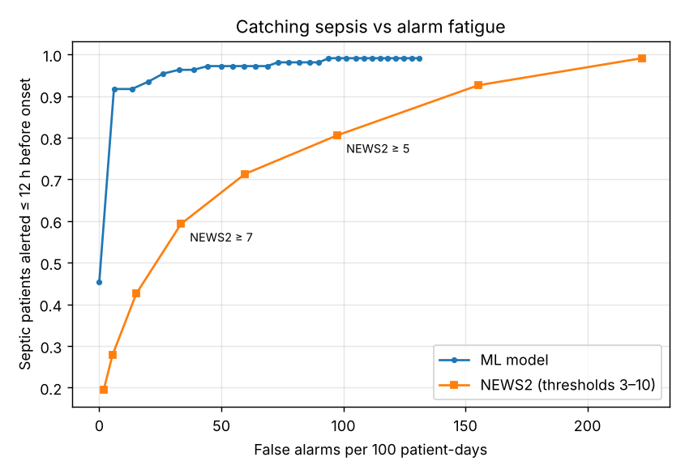
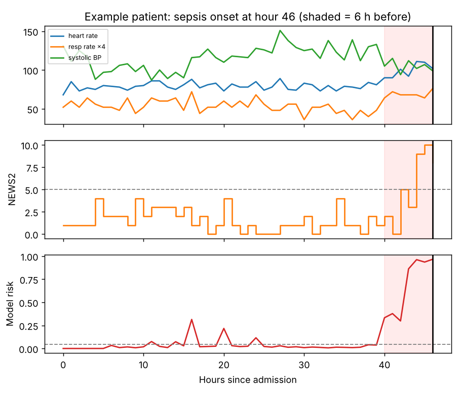
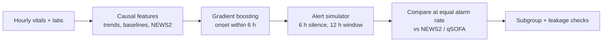

# Sepsis Early Warning: catching 96% of septic patients vs 59% for NEWS2 at the same alarm rate

**[Walkthrough notebook](notebooks/walkthrough.ipynb)** · **[Methods](docs/methods.md)** · **[Model card](docs/model_card.md)** · **[Data](data/README.md)**

## Executive summary

- **Business question.** Can a model on hourly vitals and labs warn of sepsis earlier than NEWS2 without giving nurses more false alarms?
- **Answer.** At the same false-alarm rate as **NEWS2 ≥ 7**, the model alerts **96% of septic patients** in the 12 hours before onset against **59%** for NEWS2. At *half* the alarms of NEWS2 ≥ 5 it still catches 97% (synthetic PhysioNet-style cohort, 1,200 held-out patients).
- **Recommendation.** Evaluate alerting systems on alerts, lead time and alarm burden, not AUROC; the next step is a silent prospective trial on real data under NHS clinical safety standards (DCB0129/0160).
- **Tools.** Python · scikit-learn · clinical scores (NEWS2, qSOFA) · alert simulation · Streamlit


> Research prototype on synthetic data. Not a medical device and not for clinical use.

**Problem.** Sepsis kills around 48,000 people a year in the UK, and every hour of delayed treatment raises the risk of death. NHS wards use **NEWS2**, a points-based score from vital signs, to trigger escalation. It is simple and transparent, but it fires constantly for patients who are not septic, and alarm fatigue sets in.

**Question.** Can a model trained on hourly vitals and labs warn of sepsis **earlier**, while giving nurses **no more false alarms** than NEWS2?

**Dataset.** A synthetic hourly ward/ICU cohort in the style of the PhysioNet 2019 Sepsis Challenge: 4,000 patients, 346,303 patient-hours, 10.4% develop sepsis. Split 70/30 by patient. Details in [The data](#the-data) and [data/README.md](data/README.md).

**Approach.** Causal hourly features (vital trends, deviation from each patient's baseline, sparse labs and their timing, NEWS2 and qSOFA), a class-weighted gradient-boosted classifier predicting onset within 6 hours, and an alert simulation that compares the model with NEWS2 and qSOFA **at equal false-alarm rates**. See [docs/methods.md](docs/methods.md).

**Result** (1,200 held-out patients, synthetic data): at the same false-alarm rate as the NHS emergency threshold **NEWS2 ≥ 7**, the model alerts **96% of septic patients** in the 12 hours before onset, against **59% for NEWS2**. At *half* the false alarms of NEWS2 ≥ 5, it still catches **97%**, against NEWS2 ≥ 5's 81%.

| Alert rule (test set) | Septic patients alerted | Median warning | False alarms / 100 patient-days | Alert PPV |
|---|---|---|---|---|
| qSOFA ≥ 2 | 51% | 2 h | 20.1 | 5.9% |
| NEWS2 ≥ 7 (emergency response) | 59% | 2 h | 33.5 | 4.2% |
| **ML model, same alarm rate as NEWS2 ≥ 7** | **96%** | **3 h** | **31.9** | **7.0%** |
| NEWS2 ≥ 5 (urgent response) | 81% | 5 h | 97.6 | 2.0% |
| **ML model, half NEWS2 ≥ 5's alarms** | **97%** | **4 h** | **48.8** | **4.7%** |

<p float="left">
  
  
</p>

**Row-level discrimination** (every test patient-hour):

| Score | ROC AUC | PR AUC |
|---|---|---|
| **ML model** | **0.819** | **0.369** |
| NEWS2 | 0.709 | 0.042 |
| qSOFA | 0.643 | 0.025 |

PR AUC is the more informative of the two here because only a small share of hours are positive.

## Why it's evaluated this way

Most sepsis-prediction projects stop at row-level AUROC (here 0.82 for the model against 0.71 for NEWS2). A ward doesn't experience AUROC. It experiences **alerts**. So this project simulates an alerting system:

- An alert fires when the score crosses its threshold, then stays silent for 6 hours, as real systems do to avoid repeat pages.
- A septic patient counts as **caught** if an alert fires in the 12 hours before onset. **Lead time** is how many hours early.
- **Every other alert is a false alarm**, including alerts days before onset, and is reported per 100 patient-days.
- Models are compared **at equal false-alarm rates**. That is the only fair comparison, because any score can catch every case by alarming constantly.

## Subgroup check: who gets the alarms?

Thresholds are fixed for everyone (the model at NEWS2 ≥ 7's overall alarm rate), as in deployment, so differences between groups show up. From `subgroups` in `reports/metrics.json`:

| Subgroup | Patients (septic) | Model ROC AUC | Model alerted | Model false alarms /100 pd | NEWS2 ≥ 7 alerted | NEWS2 ≥ 7 false alarms /100 pd |
|---|---|---|---|---|---|---|
| Age < 50 | 205 (24) | 0.814 | 91.7% | 19.6 | 62.5% | 36.9 |
| Age ≥ 70 | 412 (30) | 0.800 | 96.7% | 37.0 | 60.0% | 34.0 |
| COPD | 137 (19) | 0.678 | 94.7% | 22.7 | 94.7% | 168.3 |
| No COPD | 1,063 (89) | 0.855 | 96.6% | 33.1 | 51.7% | 16.5 |

- **COPD patients** trigger NEWS2 ≥ 7 ten times as often as others (scored on SpO2 scale 1 here), while the model keeps their false alarms low. But the model's ROC AUC drops to 0.678 for them: it discriminates less well where baseline physiology is abnormal.
- **Older patients** receive nearly twice the model's false alarms of under-50s (37.0 vs 19.6 per 100 patient-days).
- Septic counts per subgroup are small (19–89), so these are signals to check on real data, not conclusions. The full table, including post-operative patients, is in the [model card](docs/model_card.md).

## Leakage check: is the model just echoing the clinicians?

The most important features include *when labs were ordered* (hours since the last white cell count, number of draws in 24 h). Clinicians order more tests when they're already worried, so these signals partly encode **existing suspicion**. A model that relies on them may "predict" sepsis the team has already spotted.

The ablation retrains the model without any lab-ordering features:

| | AUROC | AUPRC | Caught at NEWS2 ≥ 7's alarm rate |
|---|---|---|---|
| Full model | 0.819 | 0.369 | 96% |
| Physiology only (no lab-ordering features) | 0.806 | 0.298 | 92% |

Most of the advantage over NEWS2 survives on physiology alone, so the model is not just mirroring the care team. The gap is still worth monitoring in deployment: this is exactly the kind of shortcut that made some commercial sepsis models underperform in external validation.

## The data

Real ICU data such as MIMIC or PhysioNet requires credentialed access, so the default cohort is **synthetic** (`src/sepsis/data.py`): 4,000 patients and ~350,000 patient-hours. Vitals are charted hourly and labs are sparse (every 6–24 h). About 10% of patients develop sepsis, with a **heterogeneous** 3–12 hour deterioration: not every patient gets a fever or low blood pressure. Non-septic patients have realistic false-alarm generators such as post-operative tachycardia, non-infective fever, COPD patients on oxygen, and slow physiological drift.

To run on the real **PhysioNet/CinC 2019 Sepsis Challenge** data, download the `.psv` files and use `sepsis.data.load_physionet_psv(folder)`. Expect lower numbers on real data, where top challenge entries reached around 0.8 AUROC.

## Demo (Streamlit, run locally)

```bash
pip install -r requirements.txt
PYTHONPATH=src python -m sepsis.train     # ~2 min: trains, evaluates, writes reports/ and models/model.joblib
streamlit run app.py                       # patient timelines + adjustable alert thresholds
```

The dashboard shows test-set patient timelines (vitals, NEWS2, model risk and alerts) and lets you move the NEWS2 and model thresholds to see sensitivity, lead time and false alarms change.

## Architecture



## Repository structure

```
├── app.py                       Streamlit dashboard
├── src/sepsis/
│   ├── scores.py                NEWS2 (RCP 2017 bands) and qSOFA, unit-tested band by band
│   ├── data.py                  synthetic cohort generator + PhysioNet 2019 loader
│   ├── features.py              causal rolling features, deviation from the patient's own baseline, missingness
│   ├── alerts.py                alert simulation, false alarms per 100 patient-days, subgroup report
│   └── train.py                 patient-level split, model, baselines, ablation, subgroups, figures
├── notebooks/walkthrough.ipynb  step-by-step analysis (executed)
├── data/README.md               how the synthetic cohort is generated, schema, using PhysioNet data
├── models/model.joblib          trained model + feature list + alert thresholds (~1.5 MB)
├── reports/                     metrics.json, test_timelines.csv.gz, figures/
├── docs/                        methods.md, model_card.md
└── tests/                       31 tests
```

## Tests

```bash
pytest -q        # 31 tests
```

Every NEWS2 band against the RCP chart, qSOFA, cohort shape and labels, a no-future-leakage test for features, the alert refractory period and counting, threshold selection by alarm burden, and the subgroup report.

## Clinical safety and governance
- **Clinical safety first.** Models are compared at equal alarm burden, because alarm fatigue is itself a patient-safety risk. The model is designed to sit alongside NEWS2, never to replace or silence it.
- **Bias and fairness checks.** Discrimination, sensitivity, lead time and false alarms are reported by age band, COPD and post-operative status. The model discriminates less well in COPD patients and gives older patients more false alarms. Sex and ethnicity are not in the synthetic data; a real validation must cover them, including the known risk that pulse oximeters over-read SpO2 in people with darker skin.
- **Shortcut check.** The ablation shows how much the model relies on lab-ordering behaviour (clinicians' suspicion) rather than physiology.
- **Explainability.** Permutation importance for the model as a whole, and patient timelines that put vitals, NEWS2 and model risk side by side for each alert.
- **Regulation (UK).** A deployed version would likely be software as a medical device, regulated by the MHRA, needing UKCA marking, clinical evaluation and post-market surveillance, plus DCB0129/DCB0160 clinical risk management and a DPIA. See the [model card](docs/model_card.md).
- **Privacy (UK GDPR).** No real patient data is used or committed. Real hourly records are special category health data and need a lawful basis, a DPIA and access-controlled processing.
- **Human oversight.** Alerts prompt clinical review; they never diagnose or start treatment.

## Limitations

- Synthetic data: results show the method, not clinical performance. Validation on real, external data is essential.
- The Sepsis-3 onset time is itself uncertain in real records, which blurs the labels.
- A deployable system needs prospective silent-mode evaluation, subgroup performance checks on real data, and clinical governance (e.g. DCB0129/DCB0160 in the NHS).
